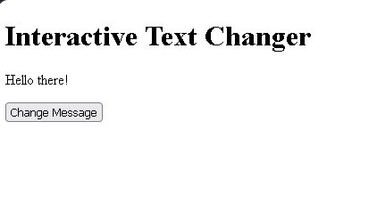
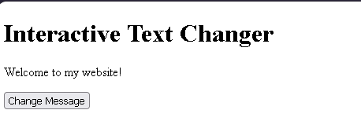
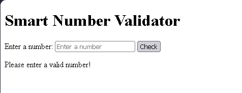
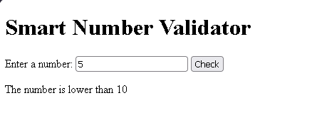
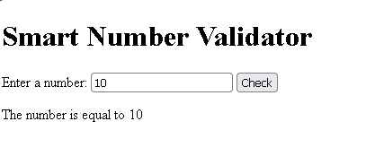
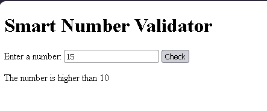
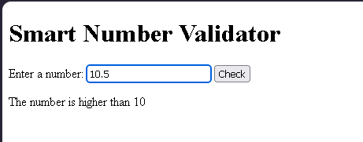
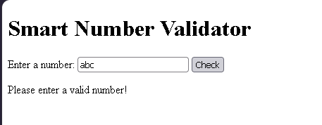
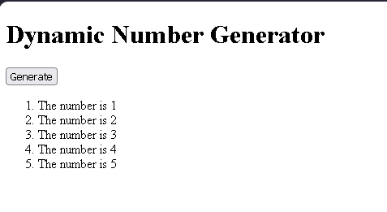

# BIC21203 — Lab 4a: Client-Side Scripting (JavaScript)

## Student Information
* **Name:** Muhammad Faizzudin bin Fariq
* **Student ID:** AI240090
* **Section:** Section 3

## Brief Explanation
This repository contains the client-side JavaScript solutions for Lab 4a, focusing on DOM manipulation, event handling, input validation, and dynamic element generation without external libraries:
* **Question 1 (`q1/`):** Interactive Text Changer — Updates a paragraph message safely using `textContent` when a button is clicked via `addEventListener()`.
* **Question 2 (`q2/`):** Smart Number Validator — Validates numeric input (including decimals), rejects empty or non-numeric strings, and compares the value against 10 using `if...else if...else`.
* **Question 3 (`q3/`):** Dynamic Number Generator — Uses a `for` loop (`1` to `5`) and `document.createElement()` to generate list items while clearing previous entries on repeated clicks.

## How to Run Each Question
1. Clone or download this repository to your local computer.
2. Open the folder for the desired question (`q1/`, `q2/`, or `q3/`).
3. Double-click the `index.html` file (or open it with Live Server in VS Code) to launch it in any modern desktop web browser.
4. Interact with the buttons and input fields on the page to test each feature.

## Output Screenshots

### Question 1 — Interactive Text Changer

### Question 2 — Smart Number Validator
\

### Question 3 — Dynamic Number Generator

